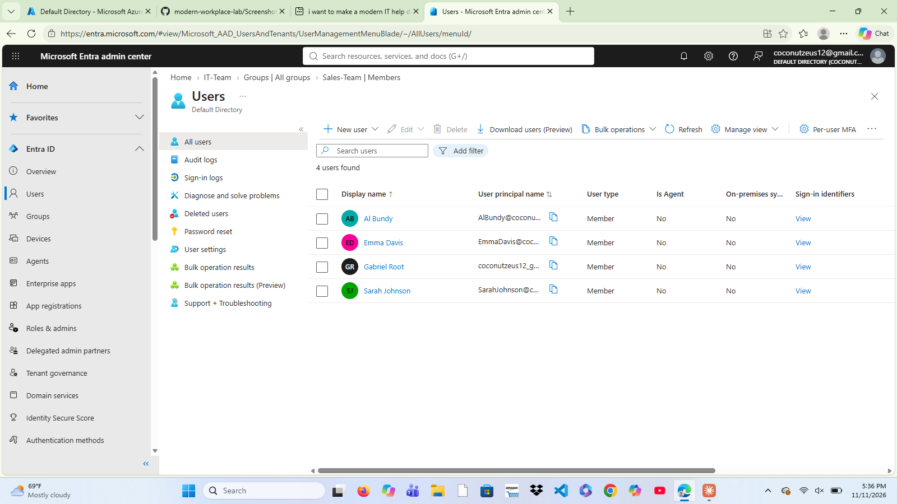
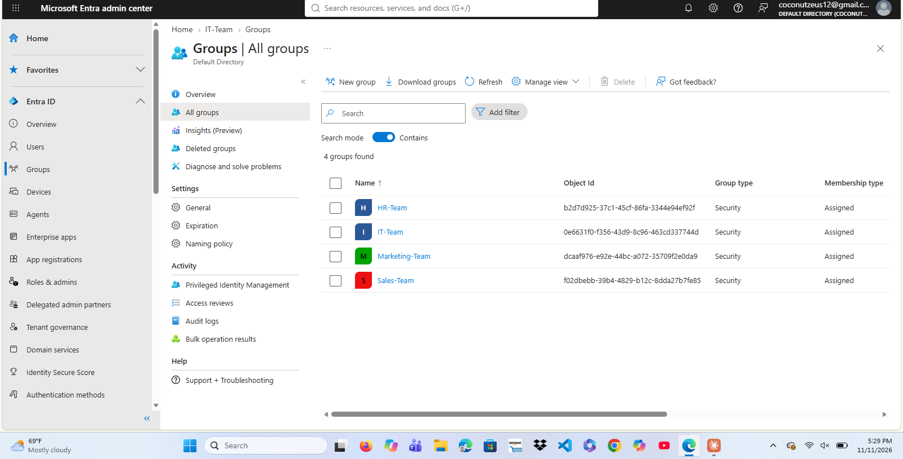
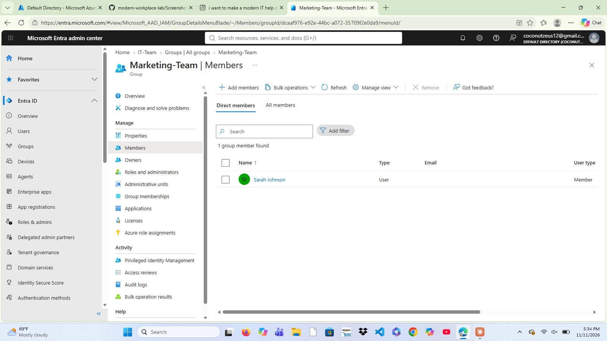
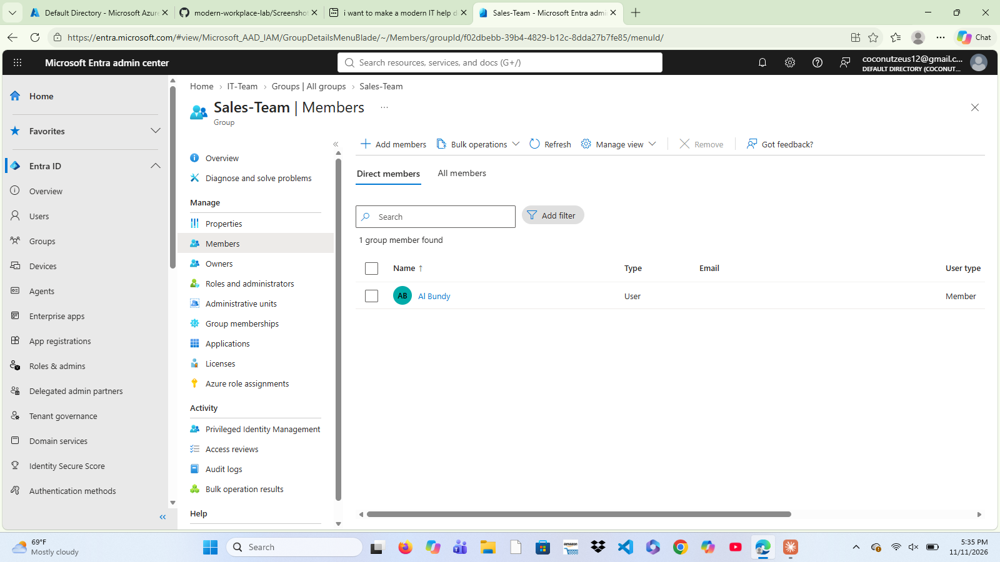
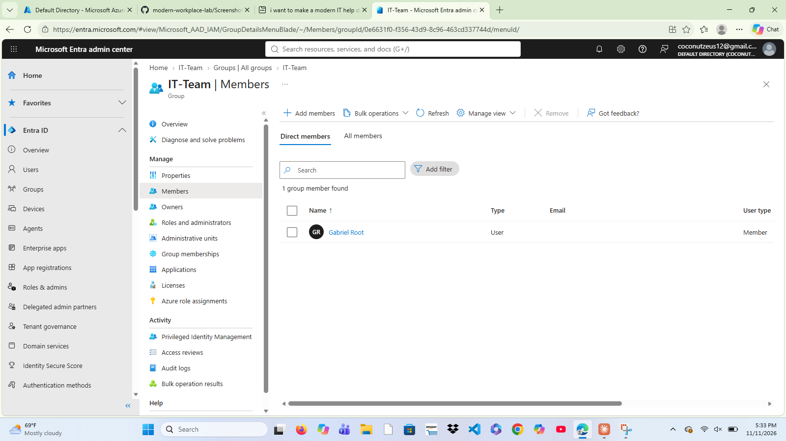

# Security Groups

## Objective

Create department-based security groups in Microsoft Entra ID to support user management and role-based access control.

## Environment

Platform: Microsoft Entra ID

Company: Apex Solutions

## Groups Created

- IT-Team
- Marketing-Team
- Sales-Team
- HR-Team

## User Memberships

| User | Department |
|--------|--------|
| Gabriel Root | IT |
| Sarah Johnson | Marketing |
| Al Bundy | Sales |
| Emma Davis | Human Resources |

## Skills Demonstrated

- Microsoft Entra ID Administration
- User Management
- Security Group Administration
- Identity and Access Management (IAM)
- Role-Based Access Control (RBAC)

## Screenshots

### All Users

### All Groups

### Marketing Team

### Sales Team

### Human Resources Team

### IT Team

## Outcome

Successfully created department security groups and assigned users to the appropriate departments within Microsoft Entra ID.
